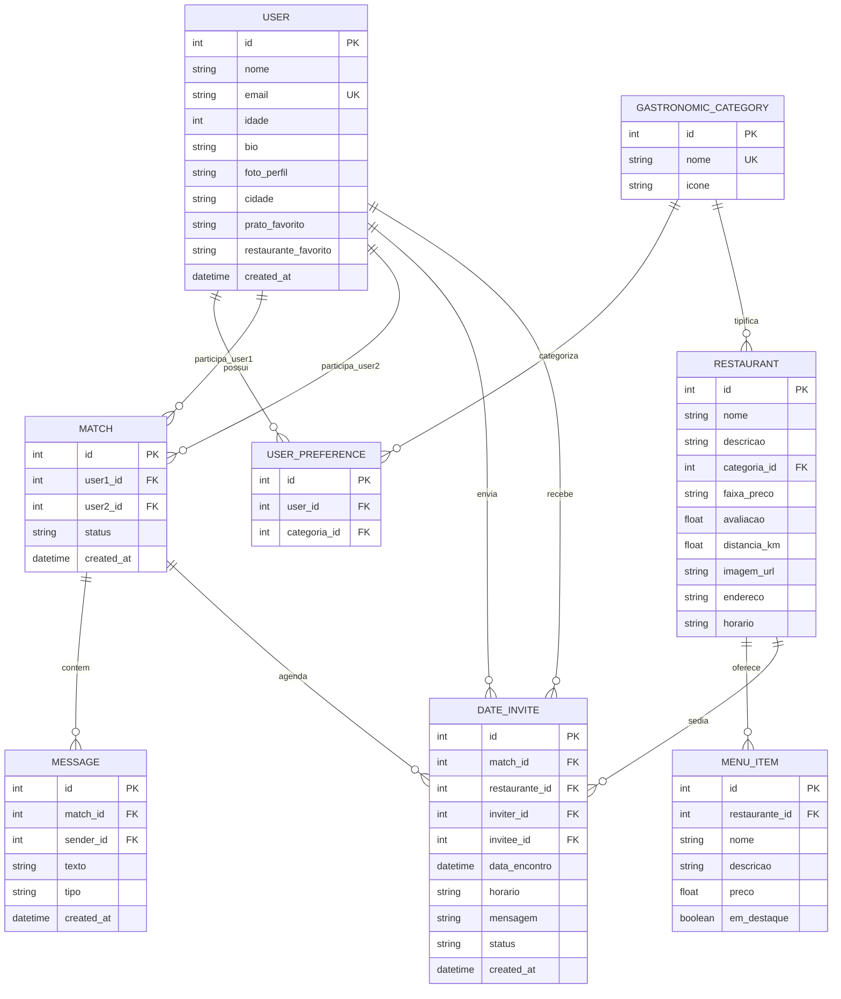

# 🏗️ Arquitetura do Sistema e Decisões Técnicas — FoodMatch (Tinder + iFood)

Este documento detalha o desenho arquitetural do MVP **FoodMatch**, o fluxo de dados entre as camadas da aplicação, o modelo de domínio para conexão por afinidades gastronômicas e a modelagem relacional implementada no PostgreSQL via Prisma ORM.

---

## 🔄 1. Fluxo de Comunicação e Camadas da Arquitetura

A arquitetura do FoodMatch foi concebida segundo o modelo em camadas e desacoplamento de responsabilidades (*Separation of Concerns - SoC*):

```text
[ Cliente Web / Frontend React 19 + Tailwind CSS ]
         │  (Interface Mobile-First, Swipe Engine, Dark Mode, Estados Reativos)
         │  
         │  Requisições HTTP / JSON (Fetch API)
         ▼
[ Camada de Servidor & API RESTful (Node.js + Express) ]
   ├── Routes (Mapeamento de Rotas Semânticas /api/feed, /api/restaurants, etc.)
   ├── Controllers (Regras de Negócio: Swipe, Cálculo de Match, Convite de Encontro)
   └── Prisma Client (Singleton ORM com tipagem estrita)
         │
         │  Protocolo TCP/IP (Porta 5432)
         ▼
[ Container Docker: PostgreSQL 16 Alpine ]
   └── Volume Nomeado (foodmatch_pgdata - Persistência Segura em Disco)
```

---

## 🗄️ 2. Modelagem do Banco de Dados Relacional

O domínio do FoodMatch modela o encontro entre duas pessoas mediado pela escolha de um restaurante parceiro e seus itens de cardápio:

1. **Usuários e Preferências ($N:M$):** Um usuário pode ter múltiplas preferências culinárias (ex: Italiana, Japonesa), e cada categoria culinária engloba múltiplos usuários através da tabela associativa `usuarios_preferencias`.
2. **Restaurantes e Cardápio ($1:N$):** Um restaurante pertence a uma categoria culinária e possui múltiplos itens em seu cardápio (`cardapio_itens`).
3. **Matches ($1:N$):** Dois usuários formam um vínculo de `Match` mútuo quando ambos curtem seus perfis gastronômicos.
4. **Mensagens do Chat ($1:N$):** Um `Match` agrega o histórico cronológico de mensagens trocadas entre os participantes.
5. **Convites de Encontro ($1:N$):** Um usuário vinculado ao match propõe um `DateInvite` associado a um `Restaurante` específico, com data, horário e status negociável (`PENDING`, `ACCEPTED`, `REJECTED`, `RESCHEDULED`).

### Diagrama Entidade-Relacionamento (Mermaid)



---

## 🛡️ 3. Boas Práticas e Decisões de Engenharia

1. **Isolamento de Infraestrutura via Docker:** O banco de dados roda em container `postgres:16-alpine`, padronizando o ambiente de desenvolvimento entre os integrantes da equipe e protegendo credenciais por meio de interpolação segura do arquivo `.env`.
2. **Padrão Singleton no Prisma Client:** O arquivo `src/database/prisma.js` garante que durante reloads de desenvolvimento não ocorra esgotamento do pool de conexões com o PostgreSQL.
3. **Resiliência e Fallback Gracioso (Offline-First):** O frontend conta com repositório de dados mockados realistas (`mockData.js`) integrado. Se o container Docker estiver offline durante uma demonstração acadêmica ou apresentação para o professor, a aplicação continua funcionando sem quebrar.
4. **Componentização e Responsividade Mobile-First:** O layout foi projetado para telas verticais de smartphones com suporte a uma moldura interativa (*Phone Frame*) e comutação instantânea para tela cheia (*Desktop*).
5. **Feedback Visual Imediato (Microinterações):** Efeitos de arrasto suave no Swipe com rotação dinâmica em graus, indicador de direção do card (*"DEU FOME! ❤️"* ou *"PASSO ❌"*), disparo de confetes com `canvas-confetti` no Match e na confirmação do encontro.
6. **Integridade Referencial Estrita:** Chaves estrangeiras de restaurantes e categorias utilizam `onDelete: Restrict` para impedir exclusão acidental de estabelecimentos que possuam encontros agendados ativos.
